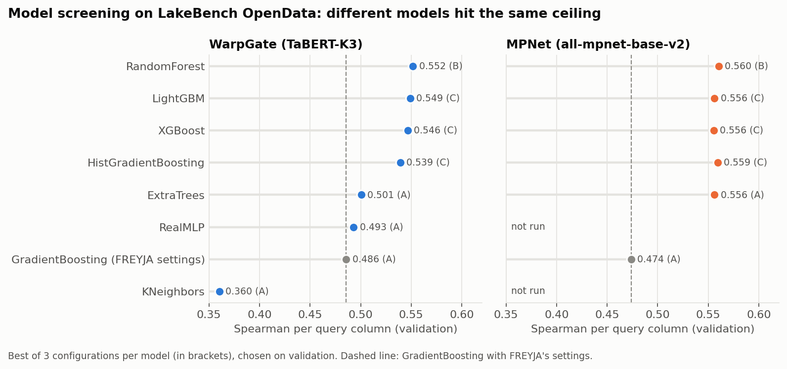
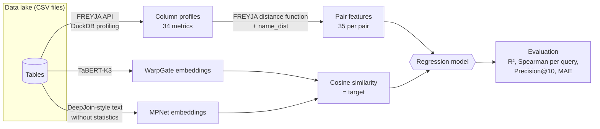
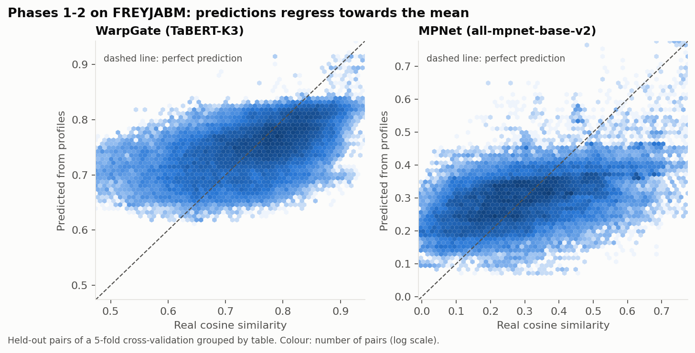
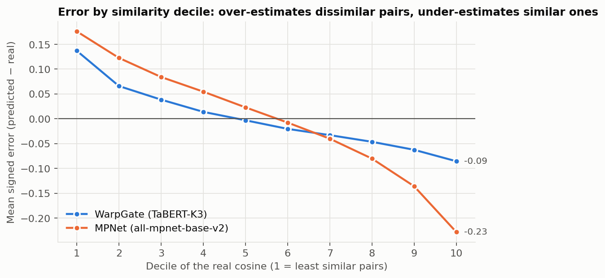
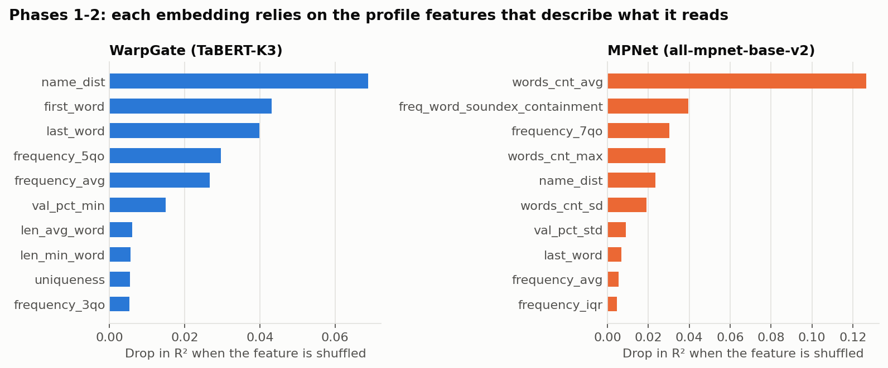
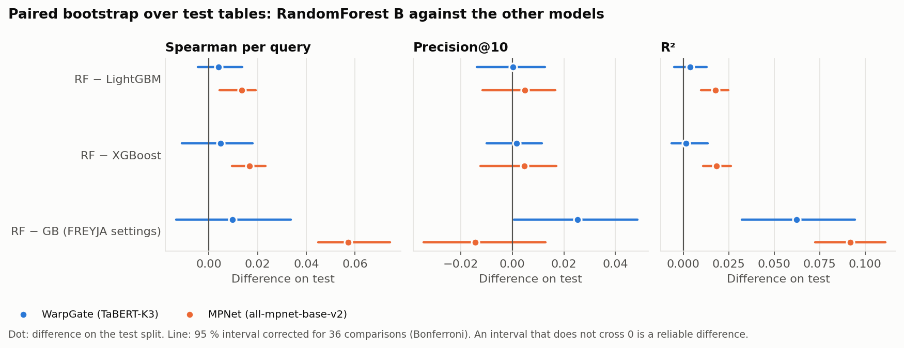
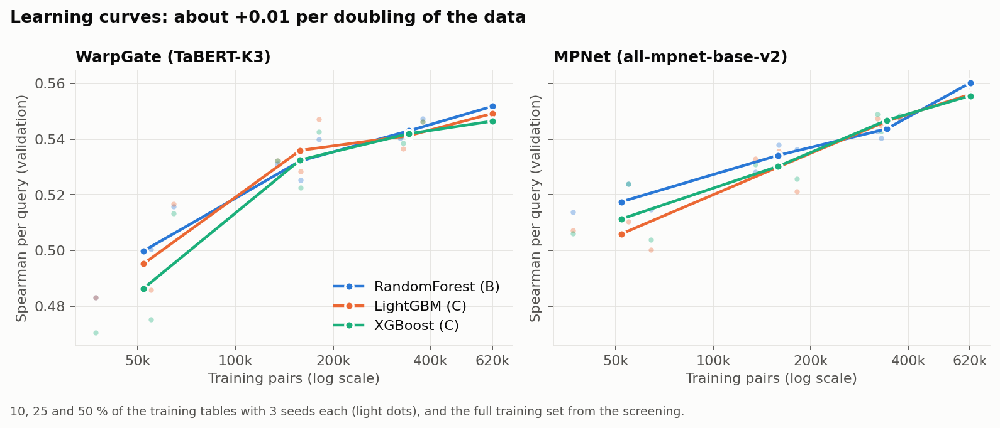

# Can column profiles predict embedding similarity?

**An empirical study on whether cheap, purely syntactic column profiles carry enough information to predict the cosine similarity between neural embeddings of tabular columns.**

  

**Author:** Carlos Martínez Nievas · Universitat Politècnica de Catalunya (UPC) · [xcarlos676@gmail.com](mailto:xcarlos676@gmail.com)

This repository contains the full experimental pipeline, results and design log of a research project I carried out on top of [FREYJA](https://github.com/dtak-upc/FREYJA), a lightweight join-discovery system for data lakes ([paper](https://arxiv.org/abs/2412.06637), IEEE TKDE 2026).

---

## Summary

| | |
|---|---|
| **Question** | Given two columns A and B, can a model that only sees the differences between their FREYJA profiles predict `cos(E(A), E(B))` for an embedding model `E`? |
| **Data** | 2 data lakes: FREYJABM (160 tables, 680 text columns) and a curated selection of LakeBench OpenData (444 tables from Canada, the USA, Singapore and the UK, 5,241 text columns) |
| **Embeddings** | 2 very different models: WarpGate (TaBERT-K3, 1,024 dims, column name + 3 rows) and MPNet (`all-mpnet-base-v2`, 768 dims, column name + distinct values) |
| **Scale** | 2.3 million column pairs on OpenData, 35 features per pair, 13 regressor families reviewed, 8 models trained, 36 model runs |
| **Answer so far** | **Yes, moderately.** Profiles explain 28 to 50 % of the variance of the cosine and recover 3 to 4 times more of the true top-10 candidates than a random ranking. The signal is stable across folds, data lakes and embedding models |
| **Main finding** | Models with very different inductive biases (bagging, boosting, neural networks) all converge to the **same ceiling** (Spearman ≈ 0.55), and learning curves add only about +0.01 per doubling of the data. The bottleneck is the information in the profiles, not the learning algorithm or the amount of data |
| **Chosen model** | RandomForest, selected on validation only. A paired bootstrap over test tables confirms it is never worse than LightGBM or XGBoost and clearly better with MPNet. Against FREYJA's own model it predicts the cosine much better (R² +0.06 to +0.09) |

<p align="center">
  
</p>

---

## Contents

1. [Motivation](#1-motivation)
2. [Research question and hypothesis](#2-research-question-and-hypothesis)
3. [Pipeline](#3-pipeline)
4. [Understanding the target: what the embeddings actually see](#4-understanding-the-target-what-the-embeddings-actually-see)
5. [Methodology: how I kept the results honest](#5-methodology-how-i-kept-the-results-honest)
6. [Results](#6-results)
7. [Limitations and open threads](#7-limitations-and-open-threads)
8. [Repository structure](#8-repository-structure)
9. [Reproducing the experiments](#9-reproducing-the-experiments)
10. [Further documentation](#10-further-documentation)
11. [Author](#author)

---

## 1. Motivation

Data discovery systems look for columns in a data lake that can be joined with a given query column. There are two broad families:

- **Profile-based systems** such as FREYJA summarise each column with a few dozen statistics (cardinality, entropy, value frequencies, word lengths, first and last word…) and compare those summaries with a lightweight model. They are fast, run on CPU and need no training per data lake.
- **Embedding-based systems** such as DeepJoin or WarpGate encode each column with a language model and compare vectors. They capture semantics (they know that `Country` and `Nation` mean the same thing) but are expensive.

If profile differences turn out to be predictive of embedding similarity, it would be empirical evidence that a **profile is a distinctive representation of a column** and that profile distances reflect differences in domain, not only in syntax. That is the claim this project tests.

## 2. Research question and hypothesis

$$
f\big(P(A),\,P(B)\big) \quad\approx\quad \cos\big(E(s(A)),\,E(s(B))\big)
$$

- `P` is the FREYJA profile of a column (34 metrics, z-score normalised over the lake).
- `s` is the serialisation of a column into text, and `E` is an embedding model.
- `f` is a regression model trained on profile **distances** (FREYJA's own distance function, 34 metrics plus `name_dist`, the Levenshtein distance between column names).

**Null hypothesis (H0):** profiles carry no information about the cosine beyond trivial baselines (predicting the mean). The goal is to refute it on unseen columns, unseen tables and several embedding models. Because what matters for discovery is **which candidates come first**, the main metric is the **Spearman correlation per query column**, not a global correlation.

## 3. Pipeline



Every step uses FREYJA's own code where it exists (profiling through its API, its distance function, its model settings as the reference), so that the results are exactly those the FREYJA authors would obtain with their code.

## 4. Understanding the target: what the embeddings actually see

Before modelling anything I studied how each embedding is computed, because the target can only be predicted from the information the profile shares with it.

### WarpGate (TaBERT-K3)

Reading FREYJA's WarpGate implementation and the TaBERT source led to a surprising hypothesis, which I then **verified empirically** by running FREYJA's unmodified `column_embedding` function on controlled inputs:

| Test on a `Country` column of 20 countries | Effect on the embedding |
|---|---|
| Replace everything from row 4 onwards | **Identical** |
| Change a value beyond its 5th token | **Identical** |
| Change the 3rd value (Italy → Brazil) | Cosine 0.997 |
| Reverse the row order | Cosine 0.981 |
| Rename only the column: `Country` → `Nation` | Cosine 0.835 |
| Rename only the column: `Country` → `c0` | Cosine 0.740 |
| Keep the name, use colour values instead | Cosine 0.879 |

**Conclusion:** the WarpGate embedding sees only the column name and the **first 3 rows**, each truncated to 5 tokens (`sample_row_num: 3`, `max_cell_len: 5` in the model config). The **name weighs as much as the values**. Measured over FREYJABM:

| Comparison of the same pairs | Pearson | Spearman per query |
|---|---|---|
| 3 random rows vs 3 other random rows | 0.920 | 0.895 |
| Real column name vs a fixed name for every column | 0.629 | 0.526 |

So the choice of rows barely matters (ceiling ≈ 0.90), while the column name, which the profile only sees as a string distance, drives a large part of the target.

### MPNet

For the second embedding I used DeepJoin's serialisation (`"<table>.csv information. <column>: v1, v2, …"`) with `sentence-transformers/all-mpnet-base-v2`, without fine-tuning. The original DeepJoin text also writes the number of distinct values and words per value, which **are also profile metrics**. Leaving them in would let the model "predict" the cosine by reading the same numbers on both sides, so I removed them (decision D32). The cosine distribution is very different from WarpGate's (mean 0.30 ± 0.16 versus 0.75 ± 0.09), which makes it a good test of generality.

## 5. Methodology: how I kept the results honest

Every decision is recorded with its rationale in [`docs/methodology.md`](docs/methodology.md) (36 numbered decisions). The most important ones:

- **No leakage between train and test.** Splits are made by **table** (and by **family** of near-duplicate tables on OpenData: same header, or a shared column with identical content), never by pair. Pairs are formed only inside each side.
- **Same-table pairs are excluded.** Columns created by the same author share formatting habits that could make unrelated columns look similar.
- **Both pair orders.** FREYJA's distances are signed, so each pair enters as (A, B) and (B, A). Statistics count each pair once.
- **Natural distribution at test time.** On OpenData every test query column is compared with **all** candidates from other test tables (1.55 million pairs, 1,277 query columns). Training uses up to 100 random candidates per column, never sampled by the target.
- **Trivial baselines.** The cosine moves in a narrow band, so a small error means nothing on its own. R² is computed against the training mean, and FREYJA's Gradient Boosting with its published settings is the reference model.
- **Model selection on validation only.** Configurations and winners are chosen on a separate validation split. The test split never takes part in a decision, which avoids the "winner's curse".
- **Fair model comparison.** Each candidate gets three configurations covering different regimes (A defaults, B constrained, C high-capacity). Early stopping is driven by the validation split. Train-versus-validation gaps are tracked to detect memorisation (Random Forest with defaults reaches R² 0.95 on train but 0.33 on validation, and constraining it improves validation).
- **Honest uncertainty.** Test results come with paired bootstrap intervals over **tables** (columns of one table are not independent), corrected for the 36 comparisons reported (Bonferroni).
- **Reproducibility.** Fixed seeds, cached intermediate results, and two isolated environments with pinned versions.

## 6. Results

### 6.1 Phases 1 and 2: FREYJABM, 5-fold cross-validation grouped by table

FREYJA's Gradient Boosting settings, untouched (100 trees, learning rate 0.05, depth 3). 680 columns, 453,620 ordered pairs. Mean (standard deviation) over the 5 folds:

| Embedding | R² | Spearman per query | Precision@10 | Precision@10 (random) |
|---|---|---|---|---|
| WarpGate | **0.321** (0.060) | **0.465** (0.101) | **0.306** (0.038) | 0.083 |
| MPNet | 0.281 (0.052) | 0.388 (0.075) | 0.264 (0.041) | 0.083 |

The model beats the mean in **every fold** with both embeddings, and it recovers about 3 of the true 10 most similar columns, **3.2 to 3.7 times more than random**.

<p align="center">
  
</p>

**Where the model fails.** It regresses towards the mean. It over-estimates dissimilar pairs and under-estimates similar ones, and the most similar pairs are exactly the ones that matter for join discovery. With MPNet the shortfall in the top decile reaches −0.23.

<p align="center">
  
</p>

**What the model learns.** Permutation importance shows that each embedding relies on the profile features describing **what that embedding reads**. With WarpGate, that is the column name (`name_dist`) and the alphabetically first and last values (`first_word`, `last_word`), the closest thing in the profile to "the first rows". With MPNet, which reads many values, it is the number of words per value (short codes versus sentences really change the text) and whether the frequent words sound alike (`freq_word_soundex_containment`).

<p align="center">
  
</p>

**Column-name semantics (v2).** Since the name is so important, I added two name-similarity features: a word-level matcher with abbreviation detection (`ctry` → `country`), and a **synonym dictionary learned from the data lake itself**, where two column names are related if their columns share most of their values (it learns pairs such as `language`–`lang`, `symbol`–`ticker`). The gain is small but consistent (R² 0.321 → 0.336, better in all 5 folds), and the idea stays purely syntactic, in FREYJA's spirit.

### 6.2 Model screening on LakeBench OpenData

To test other learning algorithms on more data, I built a curated selection of LakeBench OpenData (one table per family of near-duplicates, 444 tables), a single 60/20/20 split by table, and screened every reasonable regressor family. The candidate universe was the 55 scikit-learn regressors plus the models of the TabArena and AutoGluon benchmarks, filtered by explicit criteria (fit for regression on ~35 numeric features and up to a million rows, CPU-friendly, cheap at inference, actively maintained). Linear models (R² ≈ 0.05 in a preliminary run), kernel methods (an n×n kernel would need terabytes), single trees and tabular foundation models were ruled out with reasons.

Best configuration per model, chosen on validation, then evaluated **once** on the test split:

| Model | Train time | WarpGate Spearman val | WarpGate R² test | MPNet Spearman val | MPNet R² test |
|---|---|---|---|---|---|
| RandomForest (B) | 3.6 min | **0.552** | **0.391** | **0.560** | 0.495 |
| LightGBM (C) | 12 s | 0.549 | 0.387 | 0.556 | 0.478 |
| XGBoost (C) | 8 s | 0.546 | 0.389 | 0.556 | 0.477 |
| HistGradientBoosting (C) | 2.4 min | 0.539 | 0.350 | 0.559 | 0.466 |
| ExtraTrees (A) | 6 min | 0.501 | 0.359 | 0.556 | **0.504** |
| RealMLP (A) | 2 h 47 min | 0.493 | 0.319 | not run | not run |
| KNeighbors | 16 min | 0.360 | 0.208 | not run | not run |
| *GradientBoosting, FREYJA settings* | 5 min | *0.486* | *0.329* | *0.474* | *0.403* |

Train times are for the WarpGate run. On the test split the best models raise R² from 0.33 to 0.39 (WarpGate) and from 0.40 to 0.50 (MPNet), and Precision@10 from 0.114 to 0.140 with WarpGate. Among 1,200 candidates per query, a random ranking would score about 0.008. Precision@10 counts ties as if they were broken at random: FREYJA's model gives the same score to many candidates (a tie at rank 10 in 42 % of the queries with WarpGate), so breaking ties by data order made the metric arbitrary.

**What the screening shows:**

1. **A shared ceiling.** Bagging, boosting and a modern tabular neural network all stop at Spearman 0.54 to 0.56. When algorithms this different hit the same wall, the limit is in the input features. Better profiles should matter more than better models.
2. **Rankings depend on the embedding.** ExtraTrees is the worst tree model with WarpGate and among the best with MPNet. Checking with two embeddings was necessary. Only Random Forest (B) leads on validation with both, and only by a margin of 0.001 to 0.003.
3. **Over- and under-fitting behave as theory predicts.** Random Forest improves when constrained (it memorises with defaults). ExtraTrees gets worse when constrained (its random splits need deep trees). RealMLP shows a tiny train-validation gap (0.05), which points to under-capacity rather than over-fitting.
4. **Cost matters.** LightGBM and XGBoost reach the top group in seconds, about 1,000 times faster than RealMLP, which fits FREYJA's lightweight philosophy.

### 6.3 Choosing a model and measuring the uncertainty

**Choice on validation only.** The selection rule fixed at the start of the project (D15) says: the best validation Spearman wins, and within 0.01 the simplest model wins, with Random Forest considered simpler than boosting. RandomForest B is the best on validation with both embeddings, so it is chosen without looking at the test split (D36). The test only describes.

**Paired bootstrap over test tables.** The 89 test tables are resampled with replacement 20,000 times, and every model is evaluated on the same resampled tables. The interval of each model on its own is wide (±0.04 Spearman, because some tables are easy and others hard for every model), but the *differences* between models are much tighter, because that effect cancels out. Intervals are corrected for the 36 comparisons reported.

<p align="center">
  
</p>

- **RandomForest B is never worse** than LightGBM or XGBoost, and with MPNet it is reliably better (Spearman +0.014 to +0.017, R² +0.018).
- **Against FREYJA's model the gain is solid on the value** (R² +0.06 with WarpGate, +0.09 with MPNet) **and uneven on the order**: reliable with MPNet (Spearman +0.06), not demonstrated with WarpGate (+0.01, the interval crosses 0). With WarpGate the new models do find more of the true top 10 (+0.025). With MPNet FREYJA's model seems slightly better at the top 10, but the difference is not reliable.

**Learning curves.** Training on 10, 25 and 50 % of the training tables (3 seeds each) shows whether more data would help:

<p align="center">
  
</p>

The curves are not flat, but the returns diminish: each doubling of the data adds about 0.01 of Spearman, and the three models rise in parallel (none of them is data-hungry). Reaching 0.65 would need several hundred times more tables. The ceiling is not a wall but very slow growth, and the realistic way to move it is **better profiles**.

## 7. Limitations and open threads

I prefer to state these explicitly rather than let the headline numbers speak alone:

- **A single test split of 89 tables.** The paired bootstrap quantifies the uncertainty, but a second, independent data lake would make the conclusions stronger.
- **Validation versus test gap.** The gain over the reference is clear on validation (+0.07 Spearman) but small on test with WarpGate (+0.01). Validation compares each column with 100 random candidates and test with all of them (about 1,200), which is a harder ranking problem, and the chosen configurations are slightly optimistic on the data used to choose them.
- **Profiles cannot see meaning.** When two columns have almost identical values and differ only by their name (demonyms versus languages), their profiles are almost identical and no profile-based model can separate them. Part of the target is unreachable by construction.
- **Some models were not fully evaluated.** EBM with default interactions was stopped after 5.5 hours without finishing. CatBoost could not be loaded because the operating system's application control policy blocks its native library. HistGradientBoosting reached its 5,000-iteration cap with MPNet before early stopping triggered.

**Next steps:** a short tuning of the chosen model, predicting the Euclidean distance and dot product on **unnormalised** vectors (with unit vectors all three measures rank pairs identically), giving more weight to highly similar pairs during training only, and richer profiles.

## 8. Repository structure

```
├── README.md
├── requirements-embeddings.txt   # environment for TaBERT and MPNet (numpy 1.x)
├── requirements-ml.txt           # environment for the models (numpy 2.x)
├── docs/
│   ├── methodology.md            # every design decision (D1 to D36) with its rationale
│   ├── results.md                # all results, including intermediate and discarded ones
│   ├── data.md                   # data sources, selection funnels and known risks
│   ├── timeline.md               # chronological log of the project
│   └── figures/                  # figures used in this README
├── src/
│   ├── embeddings_warpgate.py    # WarpGate embeddings (+ row and name diagnostics)
│   ├── embeddings_mpnet.py       # MPNet embeddings, DeepJoin serialisation without statistics
│   ├── experimento.py            # phases 1-2: pairs, cosine, cross-validation, importances
│   ├── informe.py                # extra metrics (Precision@10, error in the top decile)
│   ├── comparar_modelos.py       # preliminary model comparison on FREYJABM (nested CV)
│   ├── seleccion_opendata.py     # families and selection of LakeBench OpenData
│   ├── criba.py                  # model screening on OpenData (3 configurations per model)
│   ├── analisis.py               # paired bootstrap over tables and learning curves
│   ├── figuras.py                # figures of this README
│   ├── sinonimos.py              # synonym dictionary learned from shared column content
│   └── inventario.py, repos_gittables.py, familias.py, lake_limpio.py, particion.py
│                                 # GitTables pipeline (explored, then replaced by OpenData)
└── data/                         # profiles, embeddings and results (see data/README.md)
```

The code is written in Spanish (identifiers and comments). The documentation is in English.

## 9. Reproducing the experiments

Two environments are needed because TaBERT requires `numpy<2` while FREYJA's saved profiles require `numpy>=2`.

```bash
python -m venv .venv && .venv/Scripts/pip install -r requirements-embeddings.txt
python -m venv .venv-ml && .venv-ml/Scripts/pip install -r requirements-ml.txt
```

External pieces (not included here because they are not my work):

- **FREYJA** ([dtak-upc/FREYJA](https://github.com/dtak-upc/FREYJA)), cloned next to this folder or pointed to with `FREYJA_DIR`. Its API computes the profiles (`/profiles/profile_datalake` with `varchar_only: true`) and its distance function builds the features.
- **TaBERT code** from FREYJA's WarpGate implementation (`WARPGATE_DIR`) and the `tabert_large_k3` checkpoint in `data/modelos/`.
- **Data lakes:** FREYJABM (from the FREYJA benchmarks) and LakeBench OpenData (`opendata_sampled_1k.tar.gz`, [Zenodo 15499092](https://zenodo.org/records/15499092)). See [`docs/data.md`](docs/data.md).

Profiles and embeddings are already in `data/`, so the modelling steps can be run directly:

```bash
python src/experimento.py v1 warpgate        # phase 1 (5-fold CV on FREYJABM)
python src/experimento.py v1 mpnet           # phase 2
python src/criba.py warpgate todas           # model screening on OpenData
python src/analisis.py warpgate              # bootstrap intervals on the test split
python src/analisis.py warpgate curvas       # learning curves
python src/figuras.py                        # figures
```

## 10. Further documentation

- [`docs/methodology.md`](docs/methodology.md): principles, the 36 design decisions and the reasoning behind pair sampling, metrics and model choice.
- [`docs/results.md`](docs/results.md): every result, fold by fold, including the preliminary ones.
- [`docs/data.md`](docs/data.md): the data lakes I evaluated, why GitTables was explored and then replaced, and the known risks and biases.
- [`docs/timeline.md`](docs/timeline.md): how the project evolved, day by day.

## Author

**Carlos Martínez Nievas**  
Universitat Politècnica de Catalunya (UPC)  
[xcarlos676@gmail.com](mailto:xcarlos676@gmail.com) · [GitHub](https://github.com/ccccarloswd)

I designed and carried out this project: the research question, the experimental design and every decision in [`docs/methodology.md`](docs/methodology.md), the investigation of the embedding models, the data selection, all the code in `src/`, the experiments and the analysis of the results.

## Acknowledgements

This work builds on [FREYJA](https://github.com/dtak-upc/FREYJA) (profiles, distance function and WarpGate implementation), [TaBERT](https://github.com/facebookresearch/TaBERT), [Sentence-Transformers](https://www.sbert.net/) and the [LakeBench](https://zenodo.org/records/15499092) data. I thank my supervisors for their guidance.
